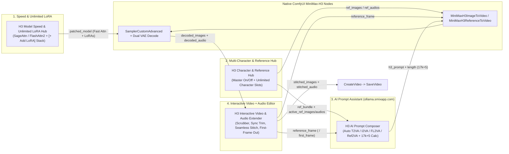

# Dokumen Konsep: ComfyUI-H3-Studio
**Interactive Video + Audio Extender, Multi-Character Reference Hub, AI Prompt Composer (`ollama.smixapp.com`), Dynamic Unlimited LoRA & Fast Attention Booster, dan 1-Click Auto Workflow untuk MiniMax H3**

---

## 1. Latar Belakang & Tujuan
Model omni-modal **MiniMax H3** (`FL2VA` dan `Ref2VA`) di ComfyUI mampu menghasilkan **Video hingga 2K (24 FPS) sekaligus Stereo Audio (32 kHz)** dalam satu kali proses sampling (`SamplerCustomAdvanced` -> `VAEDecode` + `VAEDecodeAudio`), serta mendukung:
1. **First/Last-Frame Reference (`MiniMaxH3ImageToVideo`)**: Untuk membuat video dari *first-frame*, *last-frame*, atau memperpanjang (*extend*) video.
2. **Omni-Reference (`MiniMaxH3ReferenceToVideo`)**: Mendukung hingga **9 gambar referensi (`<Picture N>`)**, **3 video referensi (`<Video N>`)**, dan **3 audio referensi (`<Audio N>`)** untuk mengunci identitas wajah/karakter (`<Subject N>`) dan timbre suara `(S1)`, `(S2)`.

Namun, pengguna menghadapi **5 kendala utama** di ComfyUI:
1. **Extend Video + Audio yang Repetitif**: Memilih frame terbaik sebelum gerakan rusak di akhir klip, memotong (*trim*) frame video sekaligus memotong *stereo audio* agar tetap sinkron, lalu menjadikan frame terakhir sebagai *first-frame* untuk segmen berikutnya sangat merepotkan.
2. **Manajemen Referensi Wajah/Karakter (On/Off & Multi-Karakter)**: Menyusun banyak karakter (`<Subject 1..N>`) dengan toggle On/Off dinamis tanpa harus cabut-pasang kabel (*wire*) di `MiniMaxH3ReferenceToVideo`.
3. **Aturan Prompting H3 yang Sangat Kompleks**: H3 mewajibkan struktur prompt presisi (`base-en.txt` untuk `T2VA/I2VA/FL2VA/L2VA` dan 6 bagian wajib `ref-en.txt` untuk `Ref2VA`) serta perhitungan jumlah frame wajib dengan rumus `17k + 5`.
4. **Kecepatan Generasi (33B Parameter) & Manajemen LoRA**: Model 33B H3 sangat berat jika hanya memakai attention standar, dan pengguna sering ingin menggabungkan Turbo LoRA (4-step / 8-step) dengan banyak Style/Character LoRA secara dinamis.
5. **Setup Workflow yang Rumit**: Merakit belasan node H3 (`UNETLoader`, `CLIPLoader qwen3vl_32b`, Dual `VAELoader`, `MiniMaxH3*`, `SamplerCustomAdvanced`, Dual Decode) secara manual memakan waktu.

**Tujuan:** Membangun ekstensi **`ComfyUI-H3-Studio`** yang dapat langsung di-install di `ComfyUI/custom_nodes/` dengan **4 Interactive Nodes** + **1-Click Complete H3 Workflow Generator**.

---

## 2. Arsitektur 4 Interactive Nodes di Canvas ComfyUI



---

### Node 1: `H3 Interactive Video & Audio Extender` (Editor di dalam Node)
Berfungsi sebagai **Interactive Video Player, Frame Scrubber, Audio+Video Sync Trimmer, dan Seamless Stitcher** langsung di atas canvas ComfyUI.

- **Inputs:**
  - `images` (`IMAGE`, opsional): Batch frame klip baru dari `VAEDecode`.
  - `audio` (`AUDIO`, opsional): Track audio stereo 32kHz dari `VAEDecodeAudio`.
  - `fps` (`FLOAT`, default: `24.0`): Frame rate standar H3.
  - `auto_skip_first_frame` (`BOOLEAN`, default: `True`): Otomatis membuang frame ke-0 (dan sampel audio 1/24 detik pertama) pada segmen ke-2 dst. agar sambungan antar-klip mulus tanpa frame kembar (*stutter*).
  - `audio_crossfade_ms` (`INT`, default: `40`): Crossfade halus (ms) pada sambungan audio antar segmen agar tidak terdengar bunyi *pop/click*.
- **Outputs:**
  - `reference_frame` (`IMAGE`): 1 frame hasil pilihan *playhead* untuk diumpankan ke `first_frame` (`MiniMaxH3ImageToVideo`) atau `ref_image_0` (`MiniMaxH3ReferenceToVideo`) serta ke `H3 AI Prompt Composer`.
  - `stitched_images` (`IMAGE`): Gabungan seluruh segmen video dari Segmen 1 s/d Segmen N yang sudah di-*trim*.
  - `stitched_audio` (`AUDIO`): Gabungan seluruh segmen audio yang otomatis dipotong sinkron dengan titik potong frame masing-masing segmen!
  - `extender_context` (`H3_EXT_CTX`): Informasi segmen aktif & durasi untuk Node AI Prompt.
- **Fitur Interactive UI (DOM Widget di Canvas):**
  - **Video Canvas Preview + Scrubber**: Play/Pause, Step `-1f` / `+1f`, Jump to Start/End, indikator waktu `00:03.500` & nomor frame.
  - **Multi-Segment Timeline Bar**: Menampilkan blok segmen `[Seg 1: 70f (2.92s)] -> [Seg 2: 65f (2.71s)]`.
  - **Tombol `[Set Playhead as Extend Point (First-Frame Ref)]`**: Mengunci frame pada posisi scrubber saat ini sebagai `reference_frame`, sekaligus memotong (*trim*) sisa frame & audio yang rusak setelah titik tersebut.
  - **Tombol `[+ Append Incoming]`, `[Undo Last Segment]`, `[Clear Timeline]`**: Memungkinkan *re-roll* segmen terakhir jika hasil generasi kurang bagus tanpa kehilangan klip sebelumnya.
  - **Tombol `[⚡ 1-Click Build Complete H3 Workflow]`**: Otomatis merakit dan menyambungkan seluruh graph MiniMax-H3 di canvas!

---

### Node 2: `H3 Model Speed & Unlimited LoRA Hub` (Fast Attention + Dynamic LoRAs)
Mengoptimalkan kecepatan inferensi model **MiniMax-H3 33B** dan memungkinkan penambahan **LoRA tanpa batas (Unlimited LoRA Stack)** secara dinamis di dalam satu node.

- **Inputs:**
  - `model` (`MODEL`): Dari `UNETLoader` (`minimax_h3_fl2va_*` atau `minimax_h3_ref2va_*`).
  - `clip` (`CLIP`, opsional): Dari `CLIPLoader` (`qwen3vl_32b_minimax_h3_*`).
  - `attention_backend` (`COMBO`):
    - `auto (Best Available: SageAttention -> FlashAttn2 -> SDPA)`
    - `sage_attention` (SageAttention INT8/FP16/FP8 untuk akselerasi tinggi pada 3D MM-RoPE H3)
    - `flash_attention_2` (FlashAttention-2)
    - `xformers`
    - `pytorch_sdpa` (PyTorch 2.0 Scaled Dot-Product Attention)
    - `comfy_default`
  - `enable_fast_fp16_accumulation` (`BOOLEAN`, default: `True`): Mengaktifkan fast FP16/BF16 matrix multiplication & cudnn benchmark.
  - `enable_torch_compile` (`BOOLEAN`, default: `False`): Opsi `torch.compile(mode="reduce-overhead")` untuk mempercepat blok transformer H3.
  - `cache_adaln_modulation` (`BOOLEAN`, default: `True`): Sesuai arsitektur H3 (di mana ~13B dari 33B parameter berada di cabang AdaLN), mengaktifkan optimasi/caching modulasi timestep jika didukung.
- **Fitur Interactive UI — Unlimited Dynamic LoRA Stack (`[+ Add LoRA]`):**
  - Pengguna bisa menekan tombol **`[+ Add LoRA]`** sebanyak yang diinginkan (Unlimited!).
  - Setiap baris LoRA di dalam node memiliki:
    - **Switch `[ON / OFF]`**: Aktifkan/matikan LoRA kapan saja (misal: menyalakan `minimax_h3_fl2v_turbo_4step` atau `8step` LoRA, ditambah LoRA karakter/gaya) tanpa menghapus barisnya.
    - **Dropdown Nama File LoRA**: Mengambil daftar otomatis dari folder `ComfyUI/models/loras/`.
    - **Slider / Input `model_strength` & `clip_strength`** (`-2.00` s/d `2.00`, default `1.00`).
    - **Tombol `[x]`**: Menghapus baris LoRA.
  - **Preset Turbo Helper**: Jika mendeteksi LoRA Turbo 4-step atau 8-step sedang **ON**, node otomatis mengeluarkan `recommended_steps` (`4` atau `8`) yang bisa langsung dicolok ke `BasicScheduler`!
- **Outputs:**
  - `model` (`MODEL`): Model H3 yang sudah di-patch dengan Fast Attention + seluruh LoRA yang berstatus **ON**.
  - `clip` (`CLIP`): CLIP yang sudah di-patch LoRA.
  - `recommended_steps` (`INT`): Otomatis bernilai `4` (jika Turbo 4-step aktif), `8` (jika Turbo 8-step aktif), atau `20` (standar tanpa Turbo LoRA).

---

### Node 3: `H3 Character & Reference Hub` (On/Off & Multi-Karakter Dinamis)
Mengelola referensi wajah/karakter (`<Subject N>`), environment (`<Picture N>`), dan suara (`<Audio N>`) dengan **Toggle On/Off** individual maupun global.

- **Inputs:**
  - `use_character_refs` (`BOOLEAN` Master Switch): On/Off seluruh referensi karakter sekaligus.
  - `first_frame_from_extender` (`IMAGE`, opsional): Jika dihubungkan dari `H3 Interactive Video & Audio Extender`, gambar ini otomatis menempati slot **`<Picture 1>` (First Frame of `[Shot 1]`)**, dan foto-foto karakter aktif otomatis bergeser mulai dari `<Picture 2>`, `<Picture 3>`, dst.!
  - Input gambar & audio multi-slot (`char_1_image` .. `char_8_image`, `char_1_audio` .. `char_3_audio`).
- **Fitur Interactive UI di dalam Node:**
  - **Tombol `[+ Add Character Slot]`**: Menambah kartu karakter secara dinamis di UI node.
  - **Toggle `[ON / OFF]` per Karakter**: Menonaktifkan karakter tertentu tanpa perlu mencabut kabel input `IMAGE` atau `AUDIO`.
  - **Auto Re-Indexing (`<Subject N>` & `<Picture N>`)**: Hanya karakter yang berstatus **ON** yang diberi nomor urut `<Subject 1>`, `<Subject 2>`, dst., sehingga tidak pernah terjadi *unresolved/skipped label* di prompt H3.
  - **Input Atribut per Karakter**:
    - *Nama Panggilan* (misal: `"Andi"`, `"Siti"` — untuk memudahkan penulisan cerita di node AI Prompt).
    - *Deskripsi Ciri Visual (`Visual Traits`)*: Misal *"pria muda berambut ikal pendek memakai jaket kulit hitam"*.
    - *Mode Retensi*: `fully_preserved`, `partially_preserved`, `attribute_transfer`, `weak_reference`.
    - *Speaker Voice Timbre*: Deskripsi suara untuk `(S1)`, `(S2)`.
- **Outputs:**
  - `h3_ref_bundle` (`H3_REF_BUNDLE`): Paket metadata lengkap untuk `H3 AI Prompt Composer`.
  - `ref_image_0` s/d `ref_image_8` (`IMAGE`): Output terurut yang siap dicolokkan langsung ke `MiniMaxH3ReferenceToVideo` (`ref_images.ref_image_0`, dst.).
  - `ref_audio_0` s/d `ref_audio_2` (`AUDIO`): Output audio referensi terurut untuk `MiniMaxH3ReferenceToVideo`.
  - `is_ref2va_active` (`BOOLEAN`): Bernilai `True` jika ada minimal 1 referensi karakter yang **ON** (berguna untuk auto-switch workflow antara `FL2VA` dan `Ref2VA`).

---

### Node 4: `H3 AI Prompt Composer (Ollama @ https://ollama.smixapp.com/)`
Mengubah ide singkat bahasa Indonesia/Inggris menjadi struktur prompt **MiniMax H3** yang 100% patuh pada panduan resmi `SKILL.md`, `base-en.txt`, dan `ref-en.txt`.

- **Inputs:**
  - `user_idea` (`STRING`, multiline): Deskripsi cerita bebas (misal: *"Andi jalan masuk ke kedai kopi yang hujan di luar, duduk di depan Siti lalu bilang 'Maaf aku telat ya'"*).
  - `mode` (`COMBO`): `Auto (Ref2VA if Characters ON, I2VA if First-Frame connected, else T2VA)`, `T2VA`, `I2VA`, `FL2VA`, `L2VA`, `Ref2VA`.
  - `duration_seconds` (`FLOAT`, default: `5.0`, range `4.0 - 15.0`).
  - `visual_style` (`COMBO`): `Live-action, cinematic`, `Realistic photographic style`, `2D-animated`, `3D CG`, `Claymation`, `Vintage film`, `Custom`.
  - `style_embedding` (`COMBO`, opsional): Mendukung 10 embedding resmi H3 (misal `none`, `embedding:minimaxh3_art_is_explosion`, dll.).
  - `h3_ref_bundle` (`H3_REF_BUNDLE`, opsional): Dari `H3 Character & Reference Hub`.
  - `first_frame_image` (`IMAGE`, opsional): Dari `H3 Interactive Video & Audio Extender`.
  - `last_frame_image` (`IMAGE`, opsional): Untuk mode `FL2VA` / `L2VA`.
- **Konfigurasi Ollama (`https://ollama.smixapp.com/`):**
  - `ollama_url`: Default `https://ollama.smixapp.com`.
  - `model_name`: Dropdown live dari `/api/tags` (`minimax-m3:cloud`, `qwen3.6:27b`, `huihui_ai/Qwen3.8-abliterated:latest`, `Qwen2.5-VL`, atau model `gemma` apa pun).
  - `use_vision_analysis` (`BOOLEAN`, default: `True`): Mengirim thumbnail *First-Frame* dan foto karakter ke model Vision di `ollama.smixapp.com` agar AI mendeskripsikan wajah, pakaian, dan komposisi frame secara akurat.
- **Outputs:**
  - `h3_prompt` (`STRING`): Prompt final berformat standar MiniMax-H3 (siap masuk ke input `prompt` pada `MiniMaxH3ImageToVideo` atau `MiniMaxH3ReferenceToVideo`).
  - `frame_length` (`INT`): Jumlah frame yang sudah dihitung otomatis menggunakan rumus resmi H3:
    $$\text{length} = \max(5, \text{round}(t \times 24)) + (5 - (\max(5, \text{round}(t \times 24)) \bmod 17)) \bmod 17$$
  - `effective_duration` (`FLOAT`): Durasi efektif dalam detik (`S.SS`) yang presisi dengan `frame_length / 24`.

---

## 3. Penyertaan Workflow Resmi & 1-Click Workflow Builder

Ekstensi ini menyertakan **Workflow Siap Pakai** di folder `example_workflows/` (otomatis muncul di menu **Workflow Templates** ComfyUI) serta tombol **`[⚡ Auto-Build H3 Workflow]`** langsung di dalam node:

1. **`H3_I2VA_Interactive_Extender_Workflow.json`**:
   - Merangkai `UNETLoader (fl2va)` + `CLIPLoader (qwen3vl_32b)` -> `H3 Model Speed & Unlimited LoRA Hub` -> `H3 AI Prompt Composer` -> `MiniMaxH3ImageToVideo` -> `SamplerCustomAdvanced` -> `VAEDecode` & `VAEDecodeAudio` -> `H3 Interactive Video & Audio Extender` -> `CreateVideo` -> `SaveVideo`.
2. **`H3_Ref2VA_MultiCharacter_Extender_Workflow.json`**:
   - Merangkai pipeline lengkap `MiniMaxH3ReferenceToVideo` dengan `H3 Character & Reference Hub` (On/Off Multi-Karakter + Voice Timbre) + `H3 AI Prompt Composer` + `H3 Interactive Video & Audio Extender`.
3. **`H3_Ultimate_Switchable_Studio_Workflow.json`**:
   - Workflow lengkap yang menggabungkan kemampuan **Multi-Character Reference (On/Off)**, **Fast Attention + Unlimited LoRA**, **AI Prompting (`ollama.smixapp.com`)**, dan **Interactive Video+Audio Extender**.

---

## 4. Struktur Direktori Final (`ComfyUI-H3-Studio`)

```text
h3/
├── __init__.py                        # Registrasi NODE_CLASS_MAPPINGS, API Routes & WEB_DIRECTORY
├── pyproject.toml                     # Metadata ComfyUI Manager & Registry
├── requirements.txt                   # Dependensi Python
├── README.md                          # Panduan instalasi & cara pakai lengkap
├── CONCEPT.md                         # Dokumen konsep & arsitektur ini
├── prompt_rules/                      # Referensi resmi MiniMax-H3 Prompt Writing
│   ├── SKILL.md
│   ├── base-en.txt
│   └── ref-en.txt
├── example_workflows/                 # Workflow JSON siap pakai untuk ComfyUI
│   ├── H3_I2VA_Interactive_Extender.json
│   ├── H3_Ref2VA_MultiCharacter_Studio.json
│   └── H3_All_In_One_Studio.json
├── nodes/
│   ├── __init__.py
│   ├── extender_node.py               # Node 1: H3InteractiveVideoExtender (Video+Audio Sync Trim & Stitch)
│   ├── model_lora_node.py             # Node 2: H3ModelSpeedAndLoraHub (Sage/FlashAttn + Unlimited LoRAs)
│   ├── character_hub_node.py          # Node 3: H3CharacterReferenceHub (On/Off Multi-Character & Audio)
│   ├── prompt_composer_node.py        # Node 4: H3AIPromptComposer (Ollama Vision/Text + 17k+5 Frame Calc)
│   ├── ollama_client.py               # Client REST ke https://ollama.smixapp.com + H3 Prompt Engine
│   └── session_store.py               # Penyimpanan segmen video+audio & frame preview server
└── web/
    ├── js/
    │   └── h3_studio_extension.js     # ComfyUI Frontend Extension (Player Scrubber, Unlimited LoRA UI,
    │                                  # Character Toggle Cards, Ollama Live Generator, 1-Click Workflow)
    └── css/
        └── h3_studio.css              # Styling UI bersih & responsif di dalam Canvas Node ComfyUI
```
